# Custom Detections as Code

**Nimble finds new threat reports. Claude writes a Microsoft Defender detection for each one and attacks it. Gemini and GPT review it. A detection engineer approves it.**

Microsoft Defender XDR custom detection rules, managed as code in Azure DevOps. An AI pipeline researches, writes, attacks, reviews and lab-tests every rule. Nothing reaches production until a person approves it.

It follows the detection engineering loop the Canadian Centre for Cyber Security (CCCS) published from its Frontier AI Lab in July 2026. It adds two things CCCS didn't have: live web research through Nimble, and a jury of other model families that checks every rule Claude writes.

Built at the AI Engineer NYC hackathon, October 11, 2026.

```mermaid
flowchart LR
    A[Nimble research<br/>18 trusted sites] --> B[Gemini triage]
    B --> C[Claude Opus 5.5<br/>drafts the rule]
    C --> D[Claude Fable 5.1<br/>attacks it by tier]
    D -->|declines| E[Claude Opus 4.8<br/>red fallback]
    D --> F[Opus hardens the rule]
    E --> F
    F --> G[Gemini + GPT jury]
    G --> H[Pull request]
    H --> I[3 days of real data<br/>bar is 0 hits]
    I --> J[Lab detonation<br/>after you approve]
    J --> K[You approve]
    K --> L[Deployed turned off]
    L --> M[7 quiet days<br/>then promotion]
```



## The first live run

Every number below comes from the first rule through the pipeline on October 11, 2026: `Defender exclusion added from the command line`.

| Gate | Result |
|---|---|
| Static and Sigma checks | PASS |
| Compiles in advanced hunting | Yes |
| Production check, 3 days, lab VM left out | 0 hits: PASS |
| Red side | Fable 5.1 declined. Opus 4.8 answered with 12 variants: 2 caught, 10 missed |
| Jury | Gemini: approve, medium false positive risk. GPT-6.1 Sol: revise, high false positive risk |
| First deploy to Defender | Succeeded in 41 seconds, rule turned off |
| Lab detonation | Fire plan posted and approved. 4 pinned Atomic Red Team tests on a Defender-onboarded VM |

The red side and the jury agreed on the real gaps. The rule misses encoded PowerShell, string concatenation, a renamed `powershell.exe` and direct writes to the Defender exclusion registry keys. GPT also caught that it matches reads and removals of exclusions, which makes it noisier than it should be. That's the spec for version 1.1. The pipeline did its job: it showed me what the rule can't see before it ever paged anyone.

| Model | Role | Calls | Input tokens | Output tokens |
|---|---|---|---|---|
| claude-fable-5-1 | Red side, first try | 1 | 1,908 | 0 (declined) |
| claude-opus-4-8 | Red side fallback | 1 | 1,910 | 2,351 |
| gemini-3.8-flash | Jury | 1 | 743 | 195 |
| gpt-6.1-sol | Jury | 1 | 796 | 471 |

### Two bugs the first run caught

1. **Forced tool choice.** Claude Opus 5.5 and Fable 5.1 return a 400 for `tool_choice` `any` or `tool`, and the code forced a tool to get structured answers. The 83 offline tests didn't catch it because they use fake clients. The fix asks with `auto`, tells the model to answer with a tool, and asks once more if it replies in plain text. A new test fails if forced tool choice ever comes back. 88 tests now.
2. **Cyber safeguards on the red side.** Fable 5.1 and Opus 5.5 both returned a refusal for the red-side prompt, with 0 output tokens. Fable stays first, and Claude Opus 4.8 now answers when it declines. The pull request always says which model answered.

## Who does what

| Stage | Who | What happens |
|---|---|---|
| Research | **Nimble** | Searches the live web for new threat reports on trusted security sites and returns each page's main content. The allowlisted feeds and analyst write-ups are added too. |
| Triage | **Gemini** (gemini-3.8-flash) | Screens each article: does it describe endpoint behavior Defender's tables record? Claude Haiku answers if Gemini isn't set up. |
| Blue side | **Claude Opus 5.5** | Drafts the KQL rule, a hunt query and a Sigma version, quoting the article for every point. Code checks every quote word for word and compiles the query in advanced hunting. |
| Red side | **Claude Fable 5.1**, then **Claude Opus 4.8** | Fable is the public Mythos-class model, like CCCS's Mythos red agent. When its cyber safeguards decline, Opus 4.8 answers. Lists bypasses by CCCS tier (baseline, cosmetic, structural, behavioral). Opus 5.5 hardens the rule, up to 3 rounds. |
| Jury | **Gemini** and **OpenAI gpt-6.1-sol** | Review the finished rule on their own: does it match the source, is the KQL correct, how noisy is it, what does it miss. If either asks for changes, Opus revises once and they vote again. |
| Production check | Code and advanced hunting | The rule over the last 3 days of real data, lab VM left out. The bar is zero hits, like CCCS's. |
| Lab | Atomic Red Team on a Defender-onboarded VM | Pinned tests run only after you approve the fire plan; the pipeline counts the rule's hits per test window. |
| Decision | **You** | Every rule is a pull request. You approve or deny; denials become lessons the blue side reads. |
| Monitoring | **Sentry** | Every pipeline run is a trace. Each model call is an AI agent span with the role (triage, blue, red, jury), model, tokens and time, and the blue to red handoffs are marked. Errors land in Sentry tagged with the pipeline and pull request. Prompts, articles, answers and keys never leave. |

Three model families check every rule, and every vote is on the pull request. The models inform; a person decides.

## How a rule gets to production

1. **Research and triage.** Draft rules (`pipelines/draft.yml`) runs every weekday. Nimble searches the domains in `config/research.yaml`; the feeds in `config/feeds.yaml` and the write-ups in `inputs/` are added. Gemini triages each new article.
2. **Propose.** Claude Opus drafts the rule with quoted evidence. Code drops any point whose quote isn't in the article, runs the static checks, and compiles the query. Failures go back for repair.
3. **Purple loop.** Claude Fable reads a handoff with the rule's clauses and lists variants by tier. Opus hardens the rule for every gap the tables can see.
4. **Jury.** Gemini and GPT review the result. One revision round if they ask for it. Each rule becomes a pull request with the tier table and every vote.
5. **Production check.** Rule checks (`pipelines/pr-checks.yml`) is the required check on every pull request: guard rails, static and Sigma checks, compile, 3 days of production data with zero hits, then the red side and the jury review the current version. If every hit is a true positive, a person adds the label the bot names (`noise-reviewed-` plus the commit's first 7 characters).
6. **Detonate.** Queuing the optional Lab detonation check posts a fire plan: the target VM, each Atomic Red Team test with its tier and exact command, and pre-flight checks. Nothing runs until you approve: the detonate service connection has an approval check and an exclusive lock. Then the VM starts, a staging check confirms the Defender sensor is running, the tests run, and the VM shuts down.
7. **Verify.** After a 10-minute wait for telemetry, the pipeline counts the rule's hits per test window, and what the lab VM recorded in that window, so a miss can be told apart from missing telemetry.
8. **Ship.** You approve and complete the pull request. Deploy rules (`pipelines/deploy.yml`) deploys it turned off (`testing`). The daily Shadow run (`pipelines/shadow.yml`) counts what each testing rule would have caught and opens a promotion pull request after 7 days with zero hits. Completing that turns the rule on.

The AI never deploys anything, never sees hunting rows, and can only open pull requests that add files under `detections/ai/` and `sigma/ai/`. Rules can't carry response actions like isolating a device.

## How it maps to CCCS

| CCCS step | Here | Same or different |
|---|---|---|
| 1. Blue team ingests a threat article | `scripts/feeds.py` with Nimble research, feeds, `inputs/` write-ups, or one URL | Added: live web research through Nimble |
| 2. Blue team proposes a detection | `scripts/draft.py` and `scripts/purple.py` with Claude Opus | Same. KQL instead of Trino SQL, because Defender runs KQL |
| 3. Red team generates an attack plan | Claude Fable lists bypasses by tier; lab variants are pinned Atomic Red Team tests | Different: no AI-written exploit code |
| 4. Red team auto-provisions a lab | One Azure VM with Defender for Endpoint, started and stopped by each run | Different: one fixed VM |
| 5. Red team executes the attack plan | `scripts/fire_plan.py` and `scripts/detonate.py`, after a person approves | Same approval: a person approves each detonation |
| 6. Blue team validates the analytic | `scripts/tp_check.py` (lab) and the production check (3 days, zero hits) | Same checks. Advanced hunting instead of Trino |
| 7. Blue team moves the rule to production | Deploy turned off, daily shadow run, promotion pull request | Same: a person approves before it's live |
| (not in CCCS) | `scripts/jury.py`: Gemini and OpenAI review every rule | Added: cross-family review, one revision round |

CCCS's Claude Code skills have matching skills in `.claude/skills/`:

| CCCS skill | This repo | What it does here |
|---|---|---|
| `/purple-loop` | `/purple-loop` | Export, plan variants, detonate, verify, decide with you, harden, record |
| `/ensure-trino-auth` | `/ensure-auth` | Checks the Azure CLI sign-in and that the service connections, variable group and pipelines exist |
| `/run-analytic` | `/run-analytic` | Re-runs the production check for a pull request and explains the result |
| `/export-analytic` | `/export-analytic` | Writes the red-side handoff file (`scripts/handoff.py`) |
| `/poc-cpp` | `/plan-variants` | Maps pinned Atomic tests to tiers and proposes existing upstream tests to allowlist |
| `/detonate-poc` | `/detonate` | Queues Lab detonation, shows the fire plan, waits for your approval in Azure DevOps |
| `/verify-evasion` | `/verify-evasion` | Reads the lab results by tier and compares them with the red side's table |

What's different from CCCS, and why:

- **No AI-written attack code.** CCCS's red agent wrote proof-of-concept code when no public one existed. This repo doesn't, not even for the lab. The lab only runs Atomic Red Team tests a person added to `config/atomics.yaml`, pinned to one commit with a SHA-256 per file. A tier no test covers is described in words.
- **Fable for the red side.** Claude Mythos 5.1 is limited to organizations Anthropic has verified, so the red side is Claude Fable 5.1, the same model with extra cybersecurity safeguards. If it declines, Opus 4.8 answers and the pull request says so. On the first live run, Fable declined.
- **One lab VM.** Building a new VM per run would give the pipeline rights to create machines and networks.
- **KQL only.** Custom detections run KQL, so every rule is KQL, with a Sigma version for other tools.

## Set it up

[docs/setup.md](docs/setup.md) goes from an Azure subscription and an Azure DevOps organization to a working pipeline in 15 steps, with 18 copy-paste blocks for Azure Cloud Shell. Plan on about 2 hours hands-on, plus the time Defender for Endpoint takes to onboard a new machine.

You need: an Azure subscription for the lab VM, Global Administrator in its tenant, an Azure DevOps organization connected to that tenant, API keys for Anthropic (required), Gemini, OpenAI and Nimble (each optional), a Sentry DSN (optional), and a GitHub account for the public copy. The models plug in by API key, so there's nothing to deploy for them. No Sentinel workspace: custom detections query Defender's own advanced hunting tables.

## Configuration

Nothing about your tenant is stored in this repo. The pipelines read names from one variable group, `detections`, and sign in to Azure through three service connections that use workload identity federation, so there are no Azure secrets. The only secrets are the four API keys, stored as secret variables.

| Variable | What it holds |
|---|---|
| `COMPANY_NAME` | Goes in front of every rule name in Defender |
| `LAB_RESOURCE_GROUP`, `LAB_VM` | The lab VM. Its hits are left out of the production check and the shadow run |
| `ANTHROPIC_API_KEY` (secret) | Anthropic API key: Claude writes, attacks and hardens rules |
| `GEMINI_API_KEY` (secret) | Gemini API key for triage and the jury |
| `OPENAI_API_KEY` (secret) | OpenAI API key for the jury |
| `NIMBLE_API_KEY` (secret) | Nimble API key for research and extraction |
| `SENTRY_DSN` (optional) | Sentry project DSN. Turns on error monitoring and AI agent tracing (`scripts/observability.py`). A plain variable: Sentry says a DSN only lets someone send events, never read them |
| `CONTENT_SAFETY_ENDPOINT` (optional) | Azure AI Content Safety endpoint; articles are screened with Prompt Shields first |

| Service connection | Identity | Checks on it |
|---|---|---|
| `detections-read` | `<repo>-read`: `ThreatHunting.Read.All` | none; pull request checks use it |
| `detections-detonate` | `<repo>-detonate`: Virtual Machine Contributor on the lab VM only | your approval, exclusive lock |
| `detections-deploy` | `<repo>-deploy`: `CustomDetection.ReadWrite.All` | branch control: only a protected `main` |

Rule names in Defender come out as `<COMPANY_NAME> - <Source> - <Title>`, for example `Contoso - MDE - Defender exclusion added from the command line`.

Pull request labels: `ai-draft` marks AI pull requests, `jury-concerns` marks ones the jury didn't approve unanimously, `promotion` marks the shadow run's promotion pull requests, and `noise-reviewed-<commit>` says a person checked every production hit of that commit.

Everything else you'd change is a file:

| File | What it controls |
|---|---|
| `config/settings.yaml` | Allowed tables and columns, frequencies, tactics, blocked KQL, the production check, lab timing, purple loop rounds, the promotion bar, which model plays which role, run limits |
| `config/research.yaml` | Nimble search queries and the trusted domains results must come from |
| `config/feeds.yaml` | Threat intel feeds, each tied to one domain |
| `config/atomics.yaml` | The only Atomic Red Team tests the lab may run, with a CCCS tier each, pinned to one commit with a SHA-256 per file |
| `inputs/` | Analyst write-ups to draft from |
| `feedback/lessons.md` | Lessons from denied drafts. The blue side reads the last 40 on every run |
| `prompts/` | Triage, blue side, red side and jury prompts |

AI pull requests can't change any of these. Rule checks fails if an `ai/` branch touches anything outside `detections/ai/` and `sigma/ai/`.

## Rule format

One YAML file per rule, named after its `id`. `scripts/deploy.py` turns it into a Microsoft Graph `detectionRule`; the rule's `id` is the custom detection's ID in Defender, so a redeploy updates the same rule.

| Field | Becomes | Notes |
|---|---|---|
| `id` | the rule's ID in Defender | lowercase words and hyphens; never changes |
| `name` | rule name and alert title | `<Source> - <Title>`; the company name goes in front at deploy |
| `description`, `recommended_actions` | alert text | plain text |
| `severity` | alert severity | `informational`, `low`, `medium` or `high` |
| `frequency` | how often it runs | `PT1H`, `PT3H`, `PT12H` or `P1D` |
| `tactics` | MITRE tactics and techniques | tactic names from `config/settings.yaml` |
| `query` | the KQL | returns `Timestamp`, `DeviceId`, `ReportId` and `DeviceName` |
| `entities` | entity mappings | `hosts`, `accounts` or `files`, each mapping settings to columns |
| `status` | turned on or off | `testing` (off), `production` (on), `retired` (off) |
| `version` | | bumped on promotion |
| `hunt_query` | not deployed | broader KQL for analysts to run by hand |
| `lab_tests` | not deployed | Atomic test GUIDs from `config/atomics.yaml` |
| `metadata` | not deployed | author, sources, evidence quotes, the purple loop's tier table, the jury's votes |

Each rule can have a Sigma version at `sigma/<folder>/<rule id>.yml` whose `name` field is the rule's id.

## Repo layout

```
.azuredevops/        pull_request_template.md
.claude/skills/      purple-loop  ensure-auth  run-analytic  export-analytic  plan-variants  detonate  verify-evasion
pipelines/           pr-checks.yml  draft.yml  detonate.yml  deploy.yml  shadow.yml
config/              settings.yaml  research.yaml  feeds.yaml  atomics.yaml
detections/lab/      rules written by people
detections/ai/       AI drafts, one pull request each
sigma/               Sigma versions of the rules
inputs/              analyst write-ups to draft from
feedback/            lessons.md
prompts/             triage.md  blue.md  red.md  jury.md
scripts/             rule checks, models, Nimble, purple loop, jury, drafting, fire plan, detonation, deploy, shadow run, Sentry
scripts/lab/         PowerShell that runs on the lab VM through Azure Run Command
tests/               offline tests with fake Graph, Azure DevOps, Claude, Gemini, OpenAI and Nimble, and a capturing Sentry transport
docs/                setup.md
```

Run the 88 tests with `python -m unittest discover --buffer --start-directory tests --top-level-directory .`. They need no network and no accounts.

## How this was built

I built this at the AI Engineer NYC hackathon on October 11, 2026. I planned the idea and built an earlier prototype before the event. None of the prototype's code is in this repo. Claude, Anthropic's AI model, wrote most of the code and docs from my requirements, using Claude Code with Claude Opus 5.5. The full commit history, with real timestamps from the event, is in my private Azure DevOps repo. This public copy is a snapshot of `main`. Every change goes through a pull request that a person approves.

Built on:

- [Canadian Centre for Cyber Security: using frontier AI to accelerate detection engineering](https://www.cyber.gc.ca/en/guidance/canadian-centre-cyber-security-used-frontier-ai-accelerate-detection-engineering)
- [Nimble](https://www.nimbleway.com) Search and Extract APIs
- [Sentry](https://sentry.io) error monitoring and AI agent tracing, with the [Python SDK](https://github.com/getsentry/sentry-python)
- The [Anthropic API](https://docs.claude.com/en/api/overview), the [Gemini API](https://ai.google.dev/gemini-api/docs) and the [OpenAI API](https://developers.openai.com/api/docs/models)
- [Atomic Red Team](https://github.com/redcanaryco/atomic-red-team) by Red Canary
- Microsoft Graph `runHuntingQuery` (v1.0) and custom detection rules (beta)
- Azure Repos and Azure Pipelines, with workload identity federation for every Azure sign-in

The custom detection rules API is in beta, and Microsoft says beta APIs aren't supported for production use.

## Security

Report problems privately. See [SECURITY.md](SECURITY.md). The full security model is at the end of [docs/setup.md](docs/setup.md).

## License

MIT. See [LICENSE](LICENSE).
